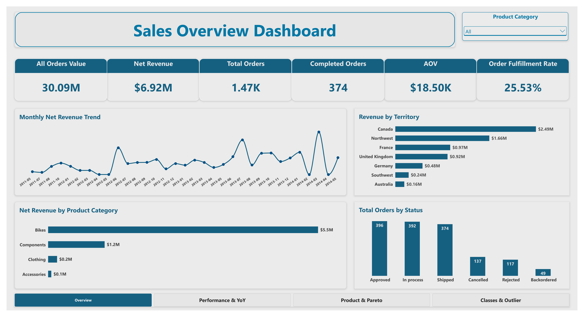
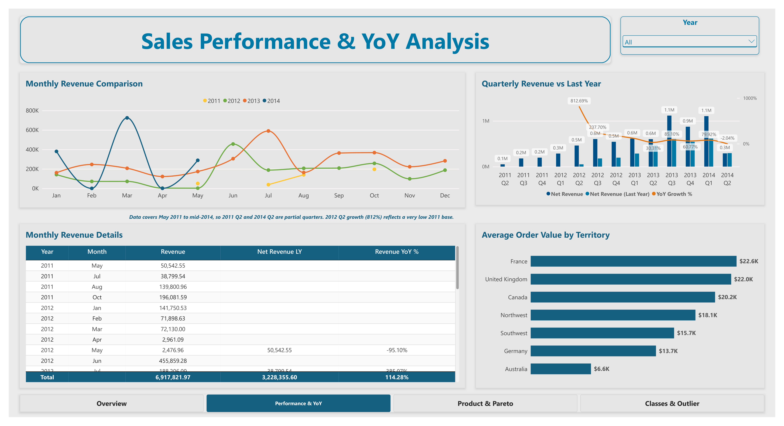
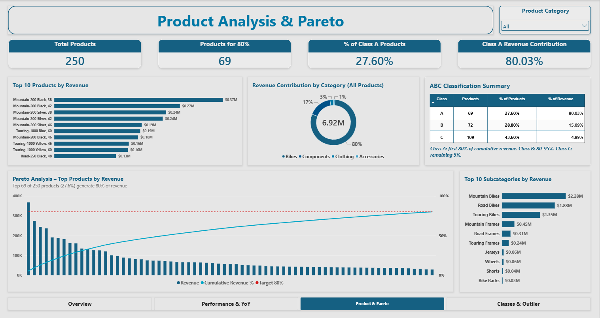
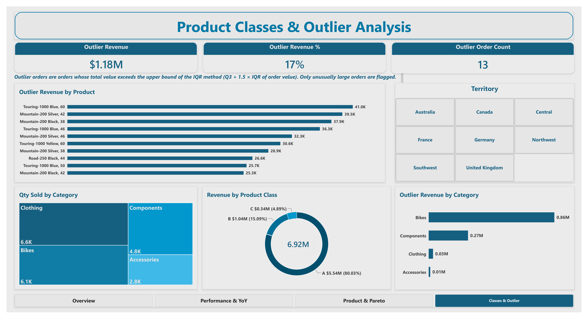

# Sales Performance Dashboard: Pareto & ABC Product Analysis

A four-page Power BI dashboard that analyzes sales for a fictional bicycle and accessories company. It focuses on two questions: **which products drive most of the revenue** (Pareto / ABC analysis) and **which orders are unusually large** (IQR outlier detection).

> **Headline finding:** 69 of 250 products (27.6%) generate 80% of net revenue.

---

## Dashboard Preview

| Overview | Performance & YoY |
|---|---|
|  |  |

| Products & Pareto | Classes & Outliers |
|---|---|
|  |  |

---

## Business Questions

- How is revenue trending, and where does it come from (territory, product category)?
- How does performance compare with the same period last year?
- Which products form the "vital few" behind 80% of revenue?
- Which unusually large orders could distort averages such as AOV?

## Data

A fictional sample dataset of a company that sells bicycles and related accessories, taken from an online course. The data covers 2011 to mid-2014; the first and last quarters are partial. The model includes a product dimension, a calendar table, a shipping-status dimension, and a small disconnected helper table used for the ABC summary.

**Revenue definition:** revenue counts **shipped orders only**. Orders that are approved, in process, backordered, cancelled, or rejected are excluded. The Net Revenue card and every revenue-based analysis in this project use this definition.

---

## Pages & Key Insights

### 1. Overview
- **Net revenue:** $6.92M (shipped orders only) from 374 shipped orders, out of 1,465 total orders. The All Orders Value card ($30.09M) is shown next to it for comparison.
- **AOV:** $18.50K. **Order fulfillment rate:** 25.53% (shipped orders / total orders). Orders that are still approved or in process count against this rate, so it should be read together with the order status chart.
- **Territory:** Canada leads with $2.49M, followed by Northwest ($1.66M).
- **Category:** Bikes generate about 80% of revenue ($5.5M), followed by Components ($1.2M).

### 2. Performance & YoY
- Quarterly net revenue is compared with the same quarter last year.
- Revenue peaks at $1.12M in 2013 Q3 and $1.10M in 2014 Q1; YoY growth in 2014 Q1 is about 80%.
- The 812% growth in 2012 Q2 reflects a very low 2011 base, not a typical growth rate.
- Average order value is highest in France ($22.6K) and the United Kingdom ($22.0K), and lowest in Australia ($6.6K).
- **Note:** the first (2011 Q2) and last (2014 Q2) quarters are partial, so comparisons involving them should be read with care.

### 3. Products & Pareto
- **69 of 250 products (27.6%)** produce **80.03%** of revenue.
- Top product: Mountain-200 Black, 38 ($0.37M).
- Mountain, Road, and Touring Bikes are the top three subcategories ($2.28M, $1.88M, and $1.35M).
- An ABC summary table shows product counts and revenue share per class.

### 4. Classes & Outliers
- **Revenue by class:** A = $5.54M (80.03%), B = $1.04M (15.09%), C = $0.34M (4.89%).
- **Outliers:** 13 orders worth $1.18M (17% of net revenue). That is about $91K per order on average, roughly five times the overall AOV. Bikes account for $0.86M of the outlier revenue and Components for $0.27M.
- **Quantity vs. revenue:** Clothing sells the most units (6.6K) but contributes only about 2.65% of revenue, while Bikes dominate revenue with fewer units.

---

## Methodology

**Pareto analysis**
Products are ranked by revenue in descending order. A cumulative revenue percentage is calculated for each product and plotted as a line over the revenue columns, with a target line at 80%. The Pareto chart shows the products up to that point, and a dynamic subtitle reports the count.

**ABC classification**
- **A:** products that make up the first 80% of cumulative revenue (the product that crosses the threshold stays in A).
- **B:** products between 80% and 95%.
- **C:** the remaining 5%.

**Outlier detection**
Revenue is calculated per shipped order, and outliers are found with the IQR method: the upper fence is `Q3 + 1.5 × IQR` and the lower fence is `Q1 − 1.5 × IQR`. In this dataset the lower fence is negative, so no order can fall below it and every flagged outlier is an unusually **large** order.

---

## Key DAX Measures

### Base revenue
Net Revenue in the dashboard is this same measure.

```dax
Revenue =
CALCULATE(
    SUM(Sales[LineTotal]),
    'Shipping-Dim'[Status] = "Shipped"
)
```

### Pareto & ABC

```dax
Product Rank =
RANKX(ALLSELECTED('Product-Dim'[Product]), [Revenue], , DESC, Dense)
```

```dax
Cumulative Revenue =
VAR CurrentRank = [Product Rank]
RETURN
    SUMX(
        FILTER(
            ALLSELECTED('Product-Dim'[Product]),
            CALCULATE([Product Rank]) <= CurrentRank
        ),
        [Revenue]
    )
```

```dax
Cumulative Revenue % =
DIVIDE(
    [Cumulative Revenue],
    CALCULATE([Revenue], ALLSELECTED('Product-Dim'[Product]))
)
```

```dax
Target 80% = 0.8
```

```dax
ABC Class =
VAR _cum = [Cumulative Revenue %]
VAR _revPct =
    DIVIDE(
        [Revenue],
        CALCULATE([Revenue], ALLSELECTED('Product-Dim'[Product]))
    )
VAR _before = _cum - _revPct
RETURN
    SWITCH(
        TRUE(),
        _before < 0.8, "A",
        _before < 0.95, "B",
        "C"
    )
```

### Year-over-year

```dax
Net Revenue LY =
CALCULATE(
    [Revenue],
    SAMEPERIODLASTYEAR('Calendar'[Date])
)
```

```dax
Revenue YoY change = [Revenue] - [Net Revenue LY]
```

```dax
Revenue YoY % = DIVIDE([Revenue YoY change], [Net Revenue LY])
```

### Outlier detection (IQR)
Q1 is calculated the same way as Q3 below, with `0.25` instead of `0.75`.

```dax
Q3 Order Revenue =
VAR ShippedOrders =
    CALCULATETABLE(
        VALUES(Sales[OrderID]),
        REMOVEFILTERS(Sales[OrderID]),
        REMOVEFILTERS('Shipping-Dim'[Status]),
        'Shipping-Dim'[Status] = "Shipped"
    )
VAR OrdersWithRevenue =
    ADDCOLUMNS(
        ShippedOrders,
        "@OrderRevenue", CALCULATE([Revenue])
    )
RETURN
    PERCENTILEX.INC(
        FILTER(OrdersWithRevenue, NOT ISBLANK([@OrderRevenue])),
        [@OrderRevenue],
        0.75
    )
```

```dax
IQR Order Revenue = [Q3 Order Revenue] - [Q1 Order Revenue]
```

```dax
Upper Bound = [Q3 Order Revenue] + (1.5 * [IQR Order Revenue])
```

```dax
Outlier Status =
VAR OrderRevenue = [Revenue]
VAR UpperLimit = [Upper Bound]
VAR LowerLimit = [Lower Bound]
RETURN
    IF(
        NOT ISINSCOPE(Sales[OrderID]) || ISBLANK(OrderRevenue),
        BLANK(),
        IF(
            OrderRevenue > UpperLimit || OrderRevenue < LowerLimit,
            "Outlier",
            "Normal"
        )
    )
```

```dax
Outlier Revenue =
SUMX(
    FILTER(VALUES(Sales[OrderID]), [Outlier Status] = "Outlier"),
    [Revenue]
)
```

---

## Limitations

- The analysis is **revenue-based**. Cost and profit data are not available, so low-revenue products should not be dropped without checking profitability first.
- Revenue counts **shipped orders only**, so the Pareto and ABC classes describe shipped revenue.
- The first and last quarters of the data are partial, which affects year-over-year comparisons.
- Outlier fences are calculated within the current filter context (for example, Product Category and date filters). The figures in this README are reported with all slicers set to **All**.
- Pareto and ABC results describe the current period and may change over time.

## Next Steps

- Add profitability (margin) to the Pareto and ABC analysis once cost data is available.
- Repeat the Pareto analysis by quantity sold, customer, and subcategory.
- Check whether Class A products stay stable from year to year.

## Tools

Power BI Desktop, DAX

## Author

Sherif Ashraf · (https://www.linkedin.com/in/sherif-ashraf-ba4802185/)

